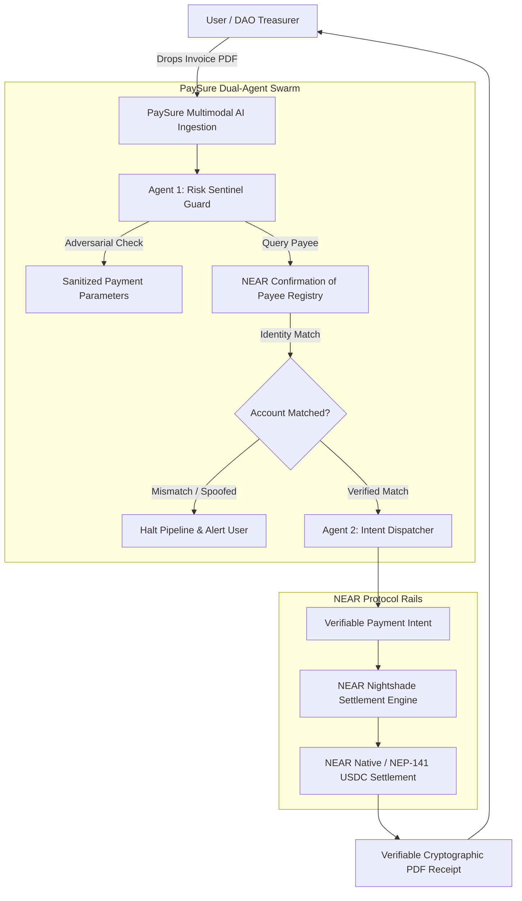

# PaySure AI — NEAR "Build Beyond Boundaries" Hackathon Specification

**Grand Prize & Multi-Track Proposal: AI Agents & NEAR Intents**

> **Tagline:** The First Autonomous Confirmation-of-Payee & Multimodal Invoicing Agent on NEAR Protocol.

---

## 1. Executive Summary & Problem

### The Problem: Address Spoofing & Blind Transfers in Web3
Every year, billions of dollars are lost across Web3 due to:
1. **Human-Readable Spoofing & Typos:** While NEAR’s human-readable account names (`alice.near`, `acme-design.testnet`) are a massive UX leap over 42-character hex addresses, they introduce a critical vulnerability: **Account ID Typos & Lookalike Spoofing** (e.g., `acme-des1gn.near` vs `acme-design.near`, or `satosh1.near` vs `satoshi.near`).
2. **Lack of Confirmation of Payee:** Unlike traditional banking (Confirmation of Payee / FedNow verification), Web3 wallets send funds blindly without verifying that the account name matches the legal counterparty.
3. **Manual Accounts Payable Friction:** DAOs and businesses spend hundreds of hours manually verifying vendor invoices from PDFs and executing individual transfers.

### The PaySure AI Solution on NEAR
PaySure AI transforms the messy, dangerous process of paying invoices into an **autonomous, fail-safe NEAR workflow**:
1. **Multimodal OCR Ingestion:** Ingests invoice images and PDFs with built-in defense against adversarial prompt-injection attacks.
2. **NEAR Confirmation of Payee:** Resolves named NEAR accounts against an on-chain identity directory, detecting typos, lookalike attacks, and address mismatches before funds leave the wallet.
3. **NEAR Intent Settlement:** Translates messy invoice data into a self-validating **Payment Intent**, settling natively in NEAR or NEP-141 USDC with sub-second finality.

---

## 2. System Architecture

---

## 3. Core Hackathon Tracks & Feature Alignment

### Track 1: AI & Autonomous Agents
- **Autonomous OCR & Prompt-Injection Defense:** Ingests raw unstructured documents and strips adversarial prompt-injection payloads (e.g., hidden text attempting to redirect funds to an attacker's account).
- **Proactive Floating Copilot:** A non-intrusive floating agent dock that monitors user routes, automatically analyzes pending invoices, and suggests identity checks.
- **Database Context Grounding:** Queries live PostgreSQL / Prisma database records to compute vendor risk scores and history.

### Track 2: NEAR Intents & Autonomous Payments
- **Intent Specification (`/api/near/intents`):** Users sign a high-level outcome (*"Pay Satoshi Dev 120 NEAR for smart contract audit"*), not low-level gas parameters.
- **Fail-Safe Intent Execution:** The agent validates the intent parameters and executes the transfer natively on NEAR with instant confirmation.

---

## 4. 3-Minute Video Demo Pitch Script

- **[0:00 - 0:30] The Hook:**
  > *"Human-readable accounts like `alice.near` made Web3 usable—but they also made typosquatting and account spoofing rampant. One letter difference between `acme-design.near` and `acme-des1gn.near`, and your treasury funds are gone forever. This is PaySure AI."*
- **[0:30 - 1:15] Multimodal AI & Anti-Injection Guard:**
  > *"Watch as we drop an invoice. The PaySure AI Sentinel extracts the payee, amount, and reference while scrubbing any hidden adversarial prompt injections. It queries our on-chain Confirmation of Payee registry and matches the legal identity to the NEAR account."*
- **[1:15 - 2:00] NEAR Intent Settlement:**
  > *"The user simply clicks confirm. Our Intent Dispatcher settles the transfer on NEAR Protocol in seconds, with zero blind transfers and complete cryptographic certainty."*
- **[2:00 - 2:40] Live Audit Trail & Verifiable Receipts:**
  > *"The payment is confirmed on NEARBlocks, generating an immutable, tamper-proof cryptographic PDF receipt for accounting."*
- **[2:40 - 3:00] Conclusion & Vision:**
  > *"PaySure AI is the autonomous trust layer for the NEAR economy. Built for the NEAR Build Beyond Boundaries Hackathon."*

---

## 5. Live Repository & Deployment Links

- **GitHub Repository:** [https://github.com/InnoOkeke/PaysureAI.git](https://github.com/InnoOkeke/PaysureAI.git)
- **Settlement Network:** NEAR Protocol (Testnet & Mainnet)
- **Explorer:** NEARBlocks ([https://testnet.nearblocks.io](https://testnet.nearblocks.io))
- **Tokens:** NEAR (Native) & USDC (NEP-141 Standard)
- **NEAR Intent Endpoint:** `/api/near/intents`
