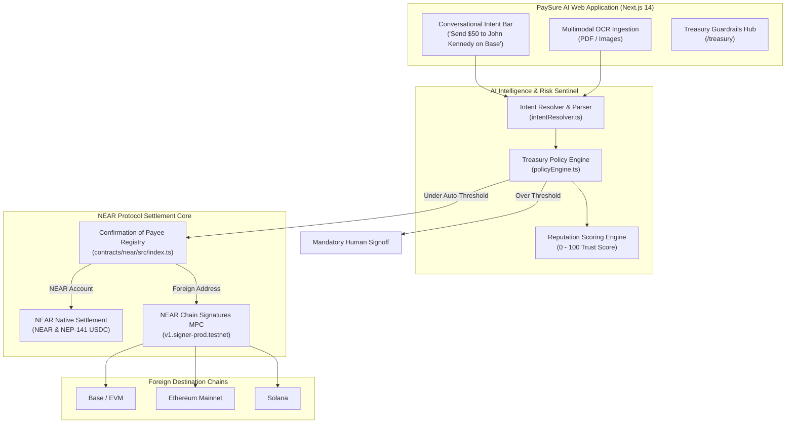

# PaySure AI — Autonomous Invoicing, Confirmation of Payee & Multi-Chain Intents on NEAR Protocol

> **"Never send business funds to a spoofed account again. Protect AI-controlled capital with verifiable Confirmation of Payee and Treasury Guardrails."**

[](https://near.org)
[](https://near.org)
[](https://near.org)
[](https://near.org)
[](https://opensource.org/licenses/MIT)

PaySure AI is an institutional-grade, autonomous invoice management, Confirmation of Payee registry, and conversational payment platform built natively on **NEAR Protocol**. It eliminates invoice fraud, account typosquatting, and unconstrained AI spending by combining **Confirmation of Payee (on-chain named-account registry)**, **Autonomous Treasury Policy Guardrails**, **Multimodal AI OCR**, and **Natural Language Cross-Chain Intents via NEAR Chain Signatures (MPC)**.

Engineered across three foundational pillars:
1. 🏦 **Corporate Money & Invoicing**: Bring everyday business payments on-chain — multimodal invoice extraction, contractor payroll, remittances, and NEP-141 USDC stablecoins.
2. 🛡️ **AI Security & Defense**: Spending limits, daily velocity caps, OutLayer attestation, counterparty reputation scoring (0–100), scam/spoofing detection, and emergency killswitches.
3. 🤖 **Autonomous Business & NEAR Intents**: Conversational multi-chain intents (*"Send $50 to John Kennedy on Base"*), auto-approval thresholds, and MPC cross-chain routing via NEAR Chain Signatures.

---

## 🏛 Core Architectural Pillars

| Pillar ID | Pillar Name | Platform Focus | PaySure AI Implementation |
| :--- | :--- | :--- | :--- |
| `realworld` | **Corporate Invoicing & Settlement** | Invoicing, payroll, remittances, and stablecoins. | • **Multimodal AI OCR**: Drag-and-drop PDF/image parsing.<br>• **NEP-141 USDC & NEAR**: Sub-second settlement.<br>• **Audit-Ready PDF Receipts**: Downloadable compliance receipts stamped with on-chain verification. |
| `security` | **AI Security & Defense** | Spending limits, wallet safeguards, scam detection. | • **OutLayer Integration**: Transaction security attestation.<br>• **Confirmation of Payee**: Eliminates typosquatting (`satosh1.near` vs `satoshi.near`).<br>• **Treasury Guardrails** (`/treasury`): Single-tx limits, 24h velocity meter, and 1-click killswitch. |
| `business` | **Autonomous Business & Intents** | AI businesses managing procurement and treasuries. | • **Conversational Intent Resolver**: Natural language prompts.<br>• **Auto-Approval Threshold**: Instant settlement under $\le \$100$.<br>• **SputnikDAO Escalation**: High-value payments route to council multi-sig. |
| `agents` | **Agent Economy & Swarms** | Agents that earn, spend, and get hired. | • **NEAR Agent Market** (`market.near.ai`): Registered agent manifest at `/api/agent`.<br>• **MCP Server**: Model Context Protocol endpoint at `/api/agent/mcp` for Claude Desktop & swarms. |
| `social` | **Social Money & Multisig** | Shared budgets and DAO governance. | • **SputnikDAO & Trezu Multi-Sig**: Direct on-chain `add_proposal` crafting to `paysure-council.sputnik-dao.testnet`. |

---

## 🌐 Ecosystem & Partner Integrations

| Partner | Category | Role in PaySure AI | Documentation & Links |
| :--- | :--- | :--- | :--- |
| **NEAR Intents** | Cross-Chain Execution | Natural language multi-chain intent resolution via Chain Signatures MPC (`v1.signer-prod.testnet`). | [Docs](https://docs.near-intents.org/) • [Website](https://intents.near.org/) |
| **HOT** | Chain Abstraction | Official NEAR Wallet Selector integration (`@near-wallet-selector/here-wallet`) for Telegram/web signing. | [Docs](https://docs.hotdao.ai/) • [Website](https://hot-labs.org/) |
| **NEAR.AI** | Private AI Inference | Decentralized AI inference cloud (`api.near.ai`) powering invoice extraction and assistant copilot. | [Docs](https://docs.near.ai/) • [Cloud](https://cloud.near.ai) |
| **SputnikDAO / Trezu** | Multisig Treasury | Autonomous escalation of high-value disbursements to DAO council multi-sig proposals. | [Docs](https://github.com/near-daos/sputnik-dao-contract) • [Trezu](https://trezu.org/) |
| **OutLayer** | Agent Security | Agent policy checks, prompt-injection defense, and cryptographic compliance attestation. | [Docs](https://app.outlayer.ai/docs/getting-started) • [Website](https://outlayer.ai/) |
| **Agent Market** | Agent Marketplace | Exposes agent tools and Model Context Protocol (`/api/agent/mcp`) to let other agents hire PaySure AI. | [Docs](https://docs.market.near.ai/) • [Market](https://market.near.ai/) |

---

## 🏛 System Architecture



---

## 🚀 Key Platform Features

### 1. Conversational Cross-Chain Intent Resolver
- Users and autonomous agents can execute payments using plain English:
  - *"Send $50 to John Kennedy on Base"*
  - *"Pay Acme Web3 Design 75 NEAR"*
  - *"Transfer $120 to Satoshi Dev on Arbitrum"*
- Automatically resolves the counterparty from Confirmation of Payee, selects the settlement rail, derives the foreign MPC address, and evaluates the payment against Treasury policies.

### 2. Confirmation of Payee (Anti-Spoofing & Lookalike Defense)
- Unlike hex addresses, NEAR accounts are human-readable (`alice.near`, `acme-design.testnet`). The primary attack vector in Web3 invoicing is lookalike homoglyph spoofing (`satosh1.near` vs `satoshi.near`).
- PaySure AI maintains an on-chain registry mapping accounts to verified legal entities with 4 safety tiers:
  - `VERIFIED`: Target account matches the registered corporate identity.
  - `WARNING`: Recent key rotation or profile changes flagged for review.
  - `UNVERIFIED`: Account not registered in directory; proceed with caution.
  - `MISMATCH`: The account extracted from the invoice contradicts known payee data (High-Risk Fraud alert).

### 3. Autonomous Treasury Guardrails (`/treasury`)
- **Single Transaction Ceilings**: Human-defined maximum for any single transfer ($500 USD).
- **Daily Velocity Caps**: Monitors rolling 24-hour volume to prevent wallet draining ($2,500 USD).
- **Autonomous Auto-Approval Threshold**: Payments under this threshold ($\le \$100$ USD) with high-reputation counterparties settle autonomously without human bottleneck.
- **SputnikDAO / Trezu Escalation**: High-value transactions escalate to DAO council multi-sig proposals.
- **OutLayer Agent Defense**: Attestation and prompt-injection firewalls.
- **Emergency Killswitch**: One-click administrative pause that blocks all outbound automated disbursements.

### 4. Multimodal AI Invoice Ingestion (`/invoices/upload`)
- Upload vendor invoices in **PDF, PNG, JPG, JPEG**.
- Automatically extracts line items, totals, invoice numbers, due dates, and payee accounts into editable drafts.
- **Adversarial Input Defense**: Invoice data is treated as untrusted input with strict Zod validation schemas to prevent prompt-injection attacks.

### 5. Multi-Wallet Selector Support
- Seamless connection via official NEAR Wallet Selector:
  - **MyNearWallet** (Official Web & Mobile)
  - **HOT Wallet** (HERE Wallet / Telegram Chain Abstraction)
  - **Meteor Wallet** (Browser Extension & Web)
  - **Nightly Wallet** (Multi-Chain Extension & Mobile)
  - **Sender Wallet** (Fast Non-Custodial Browser Extension)

---

## 📁 Repository Structure

```text
PaysureAI/
├── contracts/
│   └── near/
│       ├── src/index.ts         # Native NEAR Confirmation of Payee Smart Contract
│       └── package.json         # near-sdk-js build scripts
├── backend/                     # NestJS API (intent engine, AI orchestrator, treasury)
│   ├── src/
│   │   ├── ai/                  # Provider failover, prompts, Zod schemas, cache, audit
│   │   ├── intent/              # Deterministic parser, context builder, resolver
│   │   ├── pending/             # Quote -> confirm -> execute lifecycle
│   │   ├── treasury/            # Policy engine, OutLayer, SputnikDAO
│   │   └── ...                  # invoices, payments, recipients, dashboard, agent/MCP
│   └── package.json
├── src/
│   ├── app/
│   │   ├── page.tsx             # Fintech Landing Page
│   │   ├── dashboard/           # Financial Dashboard & KPI Metrics
│   │   ├── treasury/            # Autonomous Business & Security Guardrails Engine
│   │   ├── invoices/            # Invoice management & OCR ingestion
│   │   │   └── upload/          # Multimodal AI invoice upload
│   │   ├── recipients/          # NEAR Confirmation of Payee directory
│   │   ├── pay/                 # Conversational Intent Bar & Verified Settlement
│   │   ├── history/             # Transaction history & PDF receipts
│   │   └── api/
│   │       ├── agent/           # Agent Market manifest & Model Context Protocol (MCP)
│   │       ├── near/intents/    # NEAR Intent creation & resolution APIs
│   │       ├── ai/assistant/    # Route-aware Copilot & NEAR.AI Cloud inference
│   │       └── recipients/      # Payee verification endpoints
│   ├── components/
│   │   ├── assistant/           # Floating Autonomous Copilot
│   │   ├── navigation/          # Navbar (NEAR Account balance, switcher) & Footer
│   │   └── brand/               # PaySure AI Gateway Logo components
│   ├── context/
│   │   └── NearWalletContext.tsx # Native NEAR wallet connection state
│   └── lib/
│       ├── ai/                  # NEAR.AI Cloud client configuration
│       ├── security/            # OutLayer agent security evaluation
│       ├── near/                # Intent resolver & Chain Signatures MPC
│       ├── treasury/            # Policy Engine & SputnikDAO integration
│       └── prisma.ts            # Prisma client singleton
├── prisma/
│   └── schema.prisma            # Users, Recipients, Invoices, Payments, Receipts
└── README.md                    # Platform documentation
```

---

## 🏁 Quickstart Guide

### 1. Prerequisites
- Node.js v18+ or v20+
- `pnpm` (recommended) or `npm`
- NEAR Testnet account (free at [testnet.mynearwallet.com](https://testnet.mynearwallet.com))

### 2. Installation
```bash
git clone https://github.com/InnoOkeke/PaysureAI.git
cd PaysureAI
pnpm install
```

### 3. Environment Setup
Create a `.env` file from `.env.example`:
```bash
cp .env.example .env
```
Fill in your database URL and AI API key:
```env
DATABASE_URL="postgres://..."
NEARAI_API_KEY="your-nearai-key"
```

### 4. Build & Run
```bash
# Verify build
pnpm run build

# Start local dev server
pnpm dev
```
Open [http://localhost:3000](http://localhost:3000) to view PaySure AI.

---

## 🧠 NestJS Backend

The `backend/` app is the production API surface for PaySure AI. It reimplements every legacy Next.js route under `/api/*` and adds the AstroidBot-inspired intent engine.

### Run locally

```bash
# 1. Install backend dependencies
pnpm --dir backend install --ignore-workspace

# 2. Configure environment (copy and fill in)
cp backend/.env.example backend/.env

# 3. Push the Prisma schema (shared with the web app)
pnpm db:push:api

# 4. Start the API on http://localhost:4000/api
pnpm dev:api
```

The root `prisma/schema.prisma` is the single source of truth. Prisma needs the schema file next to the package that consumes the generated client, so the backend creates a gitignored copy at `backend/prisma/schema.prisma` during install. After editing the root schema, run `pnpm --dir backend prisma:sync` before generating or pushing.

Set `BACKEND_URL="http://localhost:4000"` in the web app `.env` to proxy all `/api/*` calls to NestJS. Leave it empty to keep using the legacy Next.js route handlers.

### What the intent engine does

1. **Deterministic fast path** parses payments, payee checks, invoice questions, and navigation with zero AI latency.
2. **Context classifier** skips database lookups for greetings and general chat.
3. **AI orchestrator** calls NEAR.AI Cloud first, falls back to DeepSeek, validates JSON with Zod, caches responses, and writes an `AIRecommendation` audit row.
4. **Resolver** matches payees against the Confirmation of Payee registry, applies treasury policy, and derives the settlement rail (NEAR native or Chain Signatures MPC).
5. **Pending actions** require an explicit confirm step, enforce quote expiry, and use atomic claims to prevent double execution. The `/pay` page prepares and confirms an approval before wallet signing, then records the transaction hash on execution.
6. **Treasury policies** are persisted per NEAR account. Velocity is computed from the last 24 hours of settled payments, and the killswitch blocks autonomous intent resolution immediately.

### Backend endpoints

| Method | Route | Purpose |
| :--- | :--- | :--- |
| `GET` | `/api/health` | Readiness probe |
| `POST` | `/api/ai/assistant` | Grounded copilot + intent handling |
| `POST` | `/api/ai/extract-invoice` | Multimodal invoice extraction |
| `POST` | `/api/near/intents/resolve` | Natural language payment resolution |
| `GET/POST` | `/api/near/intents` | Intent config and intent creation |
| `POST` | `/api/intents/prepare` | Create an expiring pending action |
| `POST` | `/api/intents/:id/confirm` | Atomically confirm a pending action |
| `POST` | `/api/intents/:id/cancel` | Cancel a pending action |
| `POST` | `/api/intents/:id/execute` | Record the signed transaction hash |
| `GET/POST` | `/api/invoices` | Invoice list and creation |
| `GET/POST` | `/api/payments` | Payment ledger and settlement recording |
| `POST` | `/api/recipients/verify` | Live NEAR RPC + registry verification |
| `GET` | `/api/dashboard` | Dashboard metrics |
| `GET/POST` | `/api/agent` | Agent Market manifest and tool dispatch |
| `GET/POST` | `/api/agent/mcp` | MCP manifest and JSON-RPC tools |
| `GET/POST` | `/api/seed` | Seed demo counterparties and invoices |
| `GET/POST` | `/api/treasury/policy` | Read or persist per-account treasury policy |
| `GET` | `/api/treasury/velocity` | Rolling 24h settled volume in USD |
| `POST` | `/api/treasury/killswitch` | Freeze or resume autonomous spending |
| `POST` | `/api/treasury/evaluate` | Evaluate a payment against live policy and velocity |

> The backend never holds wallet keys. It prepares and validates intents; the browser wallet still signs every settlement.

## 🧪 Demonstration Workflow

1. **Connect NEAR Account**: Connect in the top navbar (e.g. MyNearWallet, HOT, Meteor, Nightly, Sender).
2. **Conversational Intent**: Navigate to `/pay`. Click the sample prompt: *"Send $50 to John Kennedy on Base"*.
   - Watch the AI resolve John Kennedy's legal identity, map to Base EVM address, evaluate Treasury limits, and derive the NEAR Chain Signatures MPC signer.
3. **Treasury Guardrails Hub**: Navigate to `/treasury`. Adjust auto-approval limits, inspect rolling velocity utilization, and review vendor trust scores.
4. **Multimodal OCR Invoicing**: Navigate to `/invoices/upload`. Upload a sample PDF invoice. The AI extracts line items, validates the payee against the on-chain Confirmation of Payee registry, and highlights safety badges.
5. **Execution & Receipt**: Settle on NEAR Testnet, celebrate with confetti, and download the compliance-stamped PDF receipt.

---

## 📄 License
MIT License. © 2026 PaySure AI. All rights reserved.
