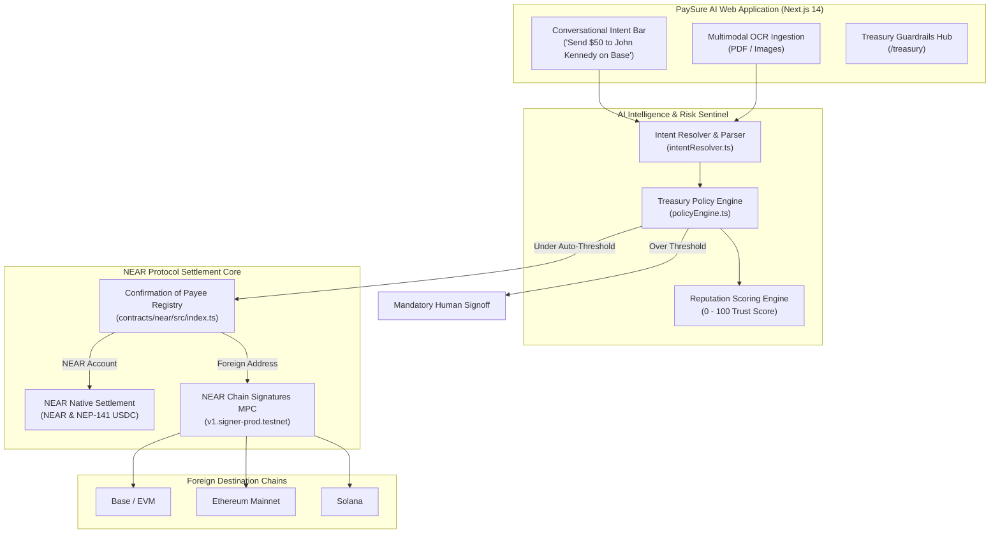

# PaySure AI — Autonomous Invoicing, Confirmation of Payee & Multi-Chain Intents on NEAR Protocol

> **"Never send business funds to a spoofed account again. Protect AI-controlled capital with verifiable Confirmation of Payee and Treasury Guardrails."**

[](https://near.org)
[](https://near.org)
[](https://near.org)
[](https://near.org)
[](https://opensource.org/licenses/MIT)

PaySure AI is an institutional-grade, autonomous invoice management, Confirmation of Payee registry, and conversational payment platform built natively on **NEAR Protocol**. It eliminates invoice fraud, account typosquatting, and unconstrained AI spending by combining **Confirmation of Payee (on-chain named-account registry)**, **Autonomous Treasury Policy Guardrails**, **Multimodal AI OCR**, and **Natural Language Cross-Chain Intents via NEAR Chain Signatures (MPC)**.

Built for the **NEAR Protocol "Build Beyond Boundaries" Hackathon ($250,000 Prize Pool)** across three core tracks:
1. 🏦 **Real-World Money**: Bring everyday business payments on-chain — invoices, contractor payroll, remittances, and NEP-141 USDC stablecoins.
2. 🛡️ **AI Security & Defense**: Spending limits, daily velocity caps, counterparty reputation scoring (0–100), scam/spoofing detection, and emergency killswitches.
3. 🤖 **Autonomous Business & NEAR Intents**: Conversational multi-chain intents (*"Send $50 to John Kennedy on Base"*), auto-approval thresholds, and MPC cross-chain routing.

---

## 🏆 Hackathon Track Alignment

| Track | Hackathon Requirement | PaySure AI Implementation |
| :--- | :--- | :--- |
| **Real-World Money** | Bring everyday business payments onchain, from payroll and invoices to remittances and stablecoin payments. | • **Multimodal AI OCR Ingestion**: Drag-and-drop PDF/image invoices with automatic line item, payee, and due date parsing.<br>• **NEP-141 USDC & NEAR**: Everyday stablecoin settlement with sub-second finality.<br>• **Audit-Ready PDF Receipts**: Downloadable compliance receipts stamped with Confirmation of Payee verification. |
| **AI Security & Defense** | Make AI-controlled money safer with spending limits, wallet safeguards, reputation systems and scam detection. | • **Autonomous Treasury Policy Engine** (`/treasury`): Human-defined spend limits and 24-hr daily velocity caps.<br>• **Confirmation of Payee**: Eliminates typosquatting and lookalike spoofing (`satosh1.near` vs `satoshi.near`).<br>• **Counterparty Reputation Scoring**: Live 0–100 trust scoring algorithm.<br>• **Emergency Killswitch**: 1-click administrative freeze. |
| **Autonomous Business & NEAR Intents** | Create AI-run businesses that manage payments, sales, procurement and treasuries within human-defined constraints. | • **Conversational Intent Resolver** (`/pay` & Floating Copilot): Natural language parser (*"Send $50 to John Kennedy on Base"*).<br>• **NEAR Chain Signatures (MPC)**: Deterministic multi-chain address derivation (`v1.signer-prod.testnet`) routing settlements to **Base**, **Ethereum**, **Arbitrum**, and **Solana**.<br>• **Autonomous Decision Matrix**: Auto-executes payments under human-configured thresholds (e.g. `< $250 USD`). |

---

## 🏛 System Architecture



---

## 🚀 Key Platform Features

### 1. Conversational Cross-Chain Intent Resolver
- Users and autonomous agents can execute payments using plain English:
  - *"Send $50 to John Kennedy on Base"*
  - *"Pay Acme Web3 Design 75 NEAR"*
  - *"Transfer $120 to Satoshi Dev on Arbitrum"*
- Automatically resolves the counterparty from Confirmation of Payee, selects the settlement rail, derives the foreign MPC address, and evaluates the payment against Treasury policies.

### 2. Confirmation of Payee (Anti-Spoofing & Lookalike Defense)
- Unlike hex addresses, NEAR accounts are human-readable (`alice.near`, `acme-design.testnet`). The primary attack vector in Web3 invoicing is lookalike homoglyph spoofing (`satosh1.near` vs `satoshi.near`).
- PaySure AI maintains an on-chain registry mapping accounts to verified legal entities with 4 safety tiers:
  - `VERIFIED`: Target account matches the registered corporate identity.
  - `WARNING`: Recent key rotation or profile changes flagged for review.
  - `UNVERIFIED`: Account not registered in directory; proceed with caution.
  - `MISMATCH`: The account extracted from the invoice contradicts known payee data (High-Risk Fraud alert).

### 3. Autonomous Treasury Guardrails (`/treasury`)
- **Single Transaction Ceilings**: Human-defined maximum for any single transfer.
- **Daily Velocity Caps**: Monitors rolling 24-hour volume to prevent wallet draining.
- **Autonomous Auto-Approval Threshold**: Payments under this threshold (e.g., $250.00 USD) with high-reputation counterparties settle autonomously without human bottleneck.
- **Department Procurement Budgets**: Allocates discrete budgets across Engineering, Design, Marketing, and Operations.
- **Emergency Killswitch**: One-click administrative pause that blocks all outbound automated disbursements.

### 4. Multimodal AI Invoice Ingestion (`/invoices/upload`)
- Upload vendor invoices in **PDF, PNG, JPG, JPEG**.
- Automatically extracts line items, totals, invoice numbers, due dates, and payee accounts into editable drafts.
- **Adversarial Input Defense**: Invoice data is treated as untrusted input with strict Zod validation schemas to prevent prompt-injection attacks.

### 5. Compliance PDF Receipts
- Generates audit-ready, downloadable PDF payment receipts containing transaction hashes, block timestamps, sender/payee accounts, and direct links to **NEARBlocks**.

---

## 🌐 NEAR Protocol Configuration

| Parameter | Value |
| :--- | :--- |
| **Blockchain Network** | `NEAR Protocol (Testnet & Mainnet)` |
| **Network ID** | `testnet` |
| **RPC Endpoint** | `https://rpc.testnet.near.org` |
| **Native Currency** | `NEAR` (24 Decimals) |
| **Settlement Stablecoin** | `USDC` (NEP-141 Standard, 6 Decimals) |
| **MPC Signer Contract** | `v1.signer-prod.testnet` |
| **Block Explorer** | `https://testnet.nearblocks.io` |
| **Wallet / Faucet** | `https://testnet.mynearwallet.com` |

---

## 🛠 Tech Stack

- **Frontend**: Next.js 14 (App Router), React 18, TypeScript, Tailwind CSS, Lucide Icons, Framer Motion, canvas-confetti, jsPDF.
- **Smart Contracts**: `near-sdk-js`, NEAR CLI, WebAssembly (`.wasm`).
- **Chain Signatures & Web3**: NEAR Protocol, NEAR Chain Signatures (MPC), NEP-141 Token Standard, Viem.
- **AI Engine**: Multimodal AI Agent with structured JSON parsing, prompt-injection defense, and conversational intent parser.
- **Backend & Database**: Next.js API Routes, Prisma ORM, PostgreSQL (Prisma Postgres on Vercel).

---

## 📂 Project Structure

```
PaysureAI/
├── contracts/
│   └── near/
│       ├── src/index.ts         # Native NEAR Confirmation of Payee Smart Contract
│       └── package.json         # near-sdk-js build scripts
├── src/
│   ├── app/
│   │   ├── page.tsx             # Fintech Landing Page
│   │   ├── dashboard/           # Financial Dashboard & KPI Metrics
│   │   ├── treasury/            # Autonomous Business & Security Guardrails Engine
│   │   ├── invoices/            # Invoice management & OCR ingestion
│   │   │   └── upload/          # Multimodal AI invoice upload
│   │   ├── recipients/          # NEAR Confirmation of Payee directory
│   │   ├── pay/                 # Conversational Intent Bar & Verified Settlement
│   │   ├── history/             # Transaction history & PDF receipts
│   │   └── api/
│   │       ├── near/intents/    # NEAR Intent creation & resolution APIs
│   │       ├── ai/assistant/    # Route-aware Copilot & intent routing
│   │       └── recipients/      # Payee verification endpoints
│   ├── components/
│   │   ├── assistant/           # Floating Autonomous Copilot
│   │   ├── navigation/          # Navbar (NEAR Account balance, switcher) & Footer
│   │   └── brand/               # PaySure AI Gateway Logo components
│   ├── context/
│   │   └── NearWalletContext.tsx # Native NEAR wallet connection state
│   └── lib/
│       ├── near/                # Intent resolver & Chain Signatures MPC
│       ├── treasury/            # Policy Engine & Reputation calculation
│       └── prisma.ts            # Prisma client singleton
├── prisma/
│   └── schema.prisma            # Users, Recipients, Invoices, Payments, Receipts
├── NEAR_HACKATHON_SPEC.md       # Full submission spec with 3-minute video script
└── README.md                    # Platform documentation
```

---

## 🏁 Quickstart Guide

### 1. Prerequisites
- Node.js v18+ or v20+
- `pnpm` (recommended) or `npm`
- NEAR Testnet account (free at [testnet.mynearwallet.com](https://testnet.mynearwallet.com))

### 2. Installation
```bash
git clone https://github.com/InnoOkeke/PaysureAI.git
cd PaysureAI
pnpm install
```

### 3. Environment Setup
Create a `.env` file from `.env.example`:
```bash
cp .env.example .env
```
Fill in your database URL and AI API key:
```env
DATABASE_URL="postgres://..."
DEEPSEEK_API_KEY="your-api-key"
```

### 4. Build & Run
```bash
# Verify build
pnpm run build

# Start local dev server
pnpm dev
```
Open [http://localhost:3000](http://localhost:3000) to view PaySure AI.

---

## 🧪 Demonstration Workflow

1. **Connect NEAR Account**: Connect in the top navbar (e.g., `company.testnet` or `alice.testnet`).
2. **Conversational Intent**: Navigate to `/pay`. Click the sample prompt: *"Send $50 to John Kennedy on Base"*.
   - Watch the AI resolve John Kennedy's legal identity, map to Base EVM address, evaluate Treasury limits, and derive the NEAR Chain Signatures MPC signer.
3. **Treasury Guardrails Hub**: Navigate to `/treasury`. Adjust auto-approval limits, inspect rolling velocity utilization, and review vendor trust scores.
4. **Multimodal OCR Invoicing**: Navigate to `/invoices/upload`. Upload a sample PDF invoice. The AI extracts line items, validates the payee against the on-chain Confirmation of Payee registry, and highlights safety badges.
5. **Execution & Receipt**: Settle on NEAR Testnet, celebrate with confetti, and download the compliance-stamped PDF receipt.

---

## 📄 License
MIT License. Built for the **NEAR Protocol "Build Beyond Boundaries" Hackathon**.
